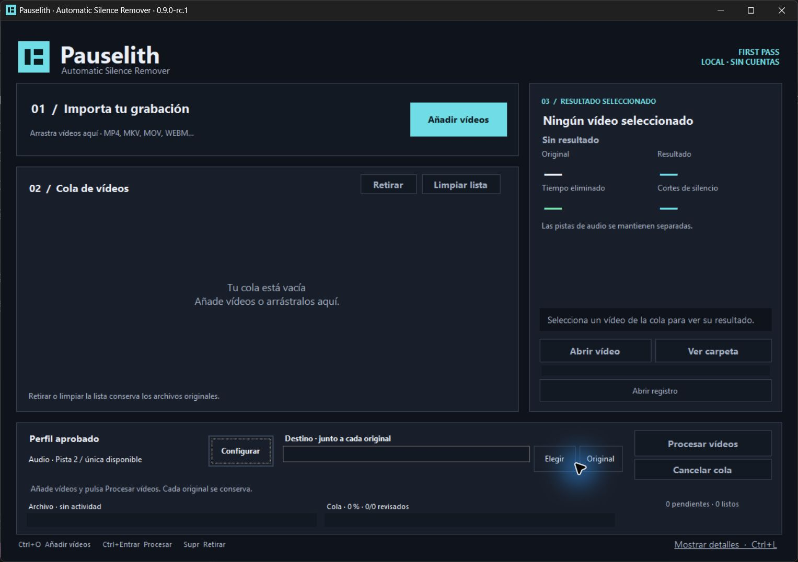
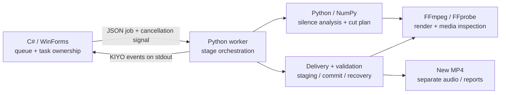
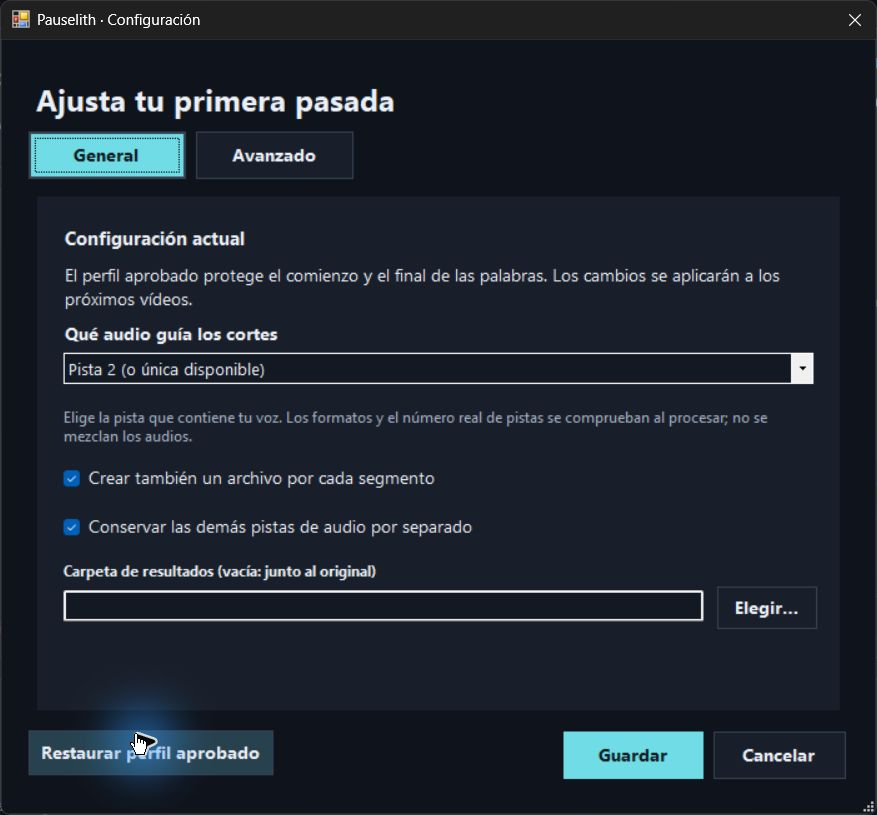

# Pauselith
### Automatic Silence Remover

A local Windows tool that turns a long recording into a first editing pass by cutting pauses on a selected audio track. It addresses a practical gameplay workflow: preserve spoken words and separate audio tracks, then continue creative editing in a full video editor.

This is an owner-directed, AI-assisted engineering portfolio project. Implementation, integration, review and testing used coding agents; this is not a claim of exclusively manual authorship. The results below describe checks actually performed locally.



## What it does

- Import or drag recordings into a queue and choose the audio track that drives the cuts.
- Remove silence with configurable thresholds and protective voice margins.
- Export a new MP4, optional segment clips, cut records and diagnostic reports.
- Preserve secondary audio separately where supported and verified.
- Show file and queue progress, measured results and distinct complete, partial, failed and cancelled states.
- Cancel cooperatively with a bounded fallback, recover interrupted work and protect completed results.
- Run locally without accounts, subscriptions or runtime network services.

The dark WinForms interface separates import, queue, settings and results. The timeline mark is branding, not a measured waveform. The UI uses Spanish labels; this portfolio documentation is in English.

## Engineering design



The interface owns only its worker process tree through a Windows Job Object. JSON jobs snapshot settings; structured events bind processing stages to the UI. A cancelled task cannot silently become a completed delivery.

The original detection/render engine is kept separate from orchestration and verification. Unique staging directories, atomic state writes, ownership checks and recovery records protect originals and completed outputs. Partial delivery remains visible when a principal video exists but another component or verification fails.

The approved product name is **Pauselith — Automatic Silence Remover**. Technical names remain **KiyoCut** in the executable, namespace, configuration paths and KIYO protocol to preserve compatibility. Existing settings stay accessible; no user-data or installer-path migration is required.

## Build, test and run

Requirements: Windows x64, .NET Framework 4.8.1 with the documented C# compiler, and 64-bit PowerShell 5.1 or newer. Python 3.11.9, NumPy 2.4.6 and Gyan FFmpeg/FFprobe 9.0.2 are fetched as locked archives; end users do not need a separate Python installation.

```powershell
.\scripts\build.ps1 -OutputDirectory '..\Pauselith-build' -CacheDirectory '..\Pauselith-cache' -DownloadDependencies
.\scripts\test.ps1 -Suite Fast -DependenciesFrom '..\Pauselith-build'
.\scripts\test.ps1 -Suite Full -DependenciesFrom '..\Pauselith-build'
```

The source snapshot contains no runtime binaries. The build obtains the locked archives externally from their providers, or uses a supplied cache; it never copies a personal installation. Use a new output directory. Omit `-DownloadDependencies` with a populated cache. Open the built `KiyoCut.exe`, choose **Añadir vídeos**, select the result folder, and press **Procesar vídeos**. Review the result before using it in an edit. Local builds do not constitute binary redistribution clearance.

Tests run without an AI and return nonzero on failure. Fast covers deterministic worker/delivery/recovery contracts. Full adds synthetic audiovisual validation, process ownership/cancellation, WinForms bindings, minimum/scaled layouts and theme checks. Results default to `../KiyoCut-Archivo/Pruebas/Ejecuciones`; source, installations and private recordings are excluded as output locations.

See [build details](docs/BUILD.md), [testing](docs/TESTING.md), [usage](docs/USAGE.md), [audio behavior](docs/AUDIO.md) and [validation scope](docs/VALIDATION.md).

<details>
<summary>General settings</summary>



</details>

## Validation and lessons

The last behavior-changing revision passed Fast **38/38** and Full **50/50** locally. A real UI run processed synthetic two-track recordings: eight seconds became approximately five seconds with three silence cuts and two confirmed audio tracks. These are fixture results, not performance claims. Selected captures show the authentic application with a neutral empty workspace and default settings so local output paths are not published.

The project demonstrates boundaries between GUI and worker processes, bounded cancellation, crash recovery, partial-success semantics, frame/audio synchronization, reproducible builds and synthetic regression testing. A central lesson was that a process exiting successfully is insufficient: delivery must be validated, and missing components must remain explicit. Another was that owner-drawn controls need contrast, focus and DPI checks beyond compilation.

## Scope and publication status

This is a focused first-pass editor, not a full video editor, subtitle generator or speech recognizer. Detection uses amplitude thresholds, not Whisper/Silero. Main MP4 encoding is lossy. Codec/media limitations can produce partial delivery; review the result. Windows 11 x64 was exercised on this host. Clean Windows, other CPUs and every DPI configuration are not certified.

The original code and project-owned documentation are licensed under [MIT](LICENSE), copyright 2026 William Campos, as expressly approved by the owner. Independent dependency terms and [third-party notices](THIRD_PARTY_NOTICES.md) remain applicable. Public binary redistribution remains blocked by documented FFmpeg corresponding-source and Microsoft runtime obligations; source-license approval does not resolve them.

The prepared first portfolio snapshot contains source/documentation without bundled executables, private development history, media, logs or runtime archives. Nothing has been published. Human review of the exact selected snapshot and express publication authorization remain. Clean-machine/binary-distribution work is separate. The prepared GitHub workflow has not run on GitHub.

[Architecture](docs/ARCHITECTURE.md) · [Contributing](CONTRIBUTING.md) · [Publication checklist](docs/RELEASING.md) · [Known redistribution limits](docs/LICENSING.md)
